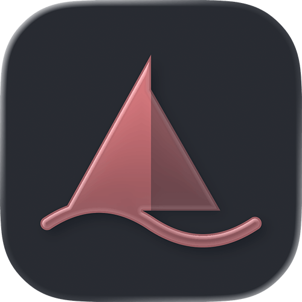
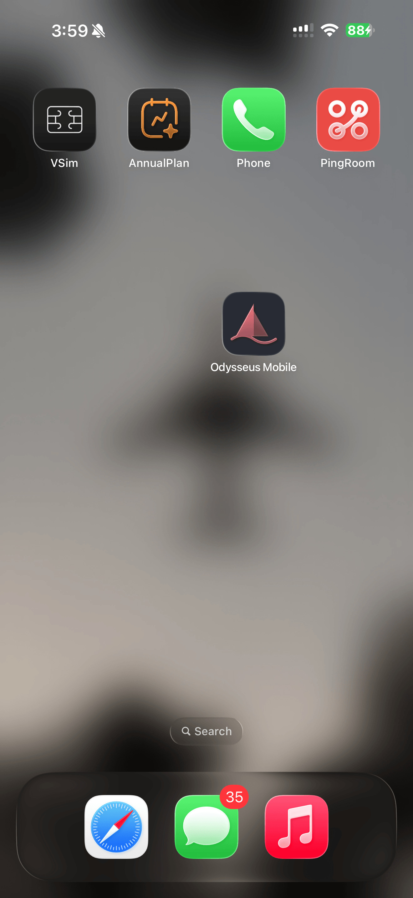
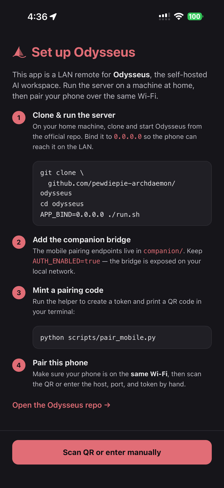
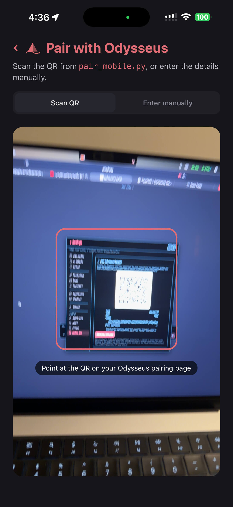
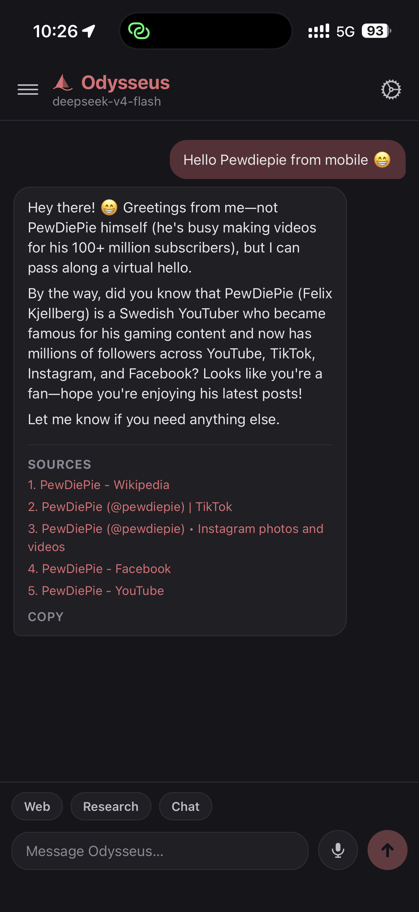
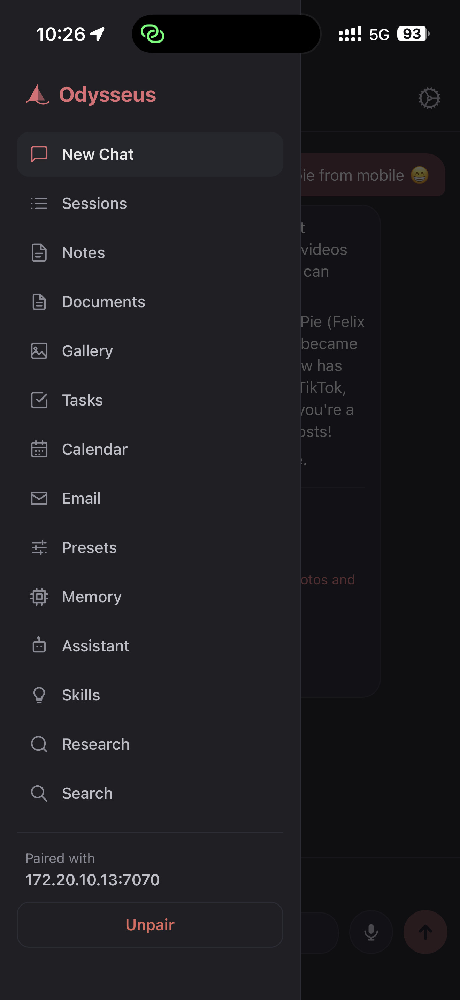
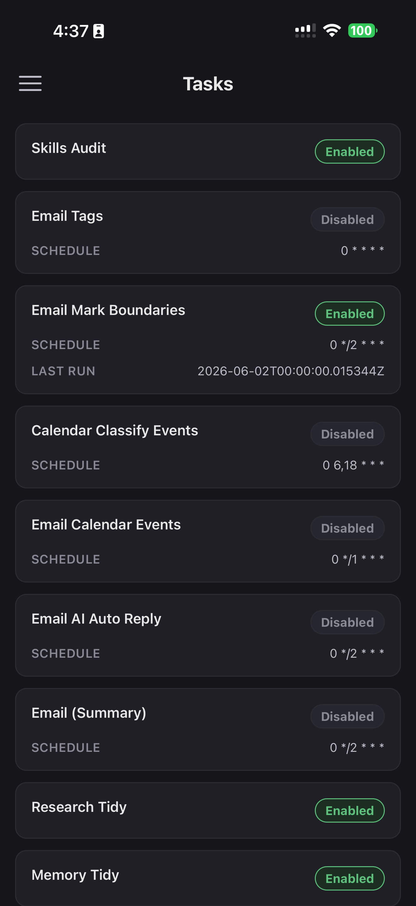

<p align="center">
  
</p>

# Odysseus Mobile

**Version 1.0.0 · Build 12**

A native iOS/Android remote for [**Odysseus**](https://github.com/odysseus-dev/odysseus),
the self-hosted AI workspace. Run Odysseus on a machine at home, pair your phone
over the same Wi-Fi, and chat with your own models — local-first, nothing leaves
your network.

Built with **Expo SDK 56** (React Native 0.85, React 19, expo-router).

Runs natively on **iPhone and iPad** from a single universal build — the iPad
gets the full app, not a stretched phone view. (iPad screenshots:
[`screenshots-ipad/`](screenshots-ipad/README.md).)

<p align="center">
  
  &nbsp;&nbsp;
  
  &nbsp;&nbsp;
  
</p>
<p align="center">
  
  &nbsp;&nbsp;
  
  &nbsp;&nbsp;
  
</p>

## Install

### iOS — TestFlight

1. Install Apple's **[TestFlight](https://apps.apple.com/app/testflight/id899247664)** app.
2. Open **[testflight.apple.com/join/qWq1A51n](https://testflight.apple.com/join/qWq1A51n)** and tap *Install*.

The **latest build (build 12)** is live on TestFlight. Please give it a spin and
send feedback — bugs, rough edges, anything — via the
[issues](https://github.com/mahdi-salmanzade/odysseus-mobile/issues) or
TestFlight's built-in feedback.

### Android — APK

Download **[`odysseus-mobile-v1.0.0-build12.apk`](https://github.com/mahdi-salmanzade/odysseus-mobile/releases/download/v1.0.0-build.12/odysseus-mobile-v1.0.0-build12.apk)**
from the [Build 12 release](https://github.com/mahdi-salmanzade/odysseus-mobile/releases/tag/v1.0.0-build.12)
and install it (allow *install from unknown sources* if prompted).

> Either way, you'll need an Odysseus server on your LAN with the companion
> bridge — see [Prerequisites](#prerequisites) and [Pairing](#pairing) below.

## What's new in Build 12

- **Reach your server from anywhere** — pair over **HTTPS** to an Odysseus behind
  a TLS reverse proxy (`tailscale serve`, Caddy, nginx), instead of only over the
  same Wi-Fi. Turn on *Use HTTPS* when pairing, or just paste an `https://…`
  address. See [Remote access](#remote-access-tailscale-wireguard-reverse-proxy).
  Reported in [#2](https://github.com/mahdi-salmanzade/odysseus-mobile/issues/2)
  by [@FUenal](https://github.com/FUenal) — thank you.
- **Clearer setup docs** — the README now points at the single consolidated
  companion-bridge PR and says exactly which screen isn't available upstream.

## What's new in Build 11

- **12 themes, including light modes** — choose one in **Settings → Appearance**.
- **Seven languages** — English, Spanish, French, German, Portuguese, Arabic,
  and Persian, with device-language detection and right-to-left layout.
- **Richer chat** — view assistant thinking in a collapsible block, follow agent
  tool calls, and read syntax-highlighted code blocks.
- **Read aloud and multilingual dictation** — hear assistant replies using
  on-device text-to-speech, and dictate in the selected language.
- **Task controls** — run, pause, resume, or stop scheduled tasks from the app.
- **Gallery favorites** — add or remove a favorite from the image viewer.
- **Email AI** — summarize a message or draft a reply with your own model.
- **Cached model browser** — inspect the server's model inventory from
  **Admin → Cookbook**. (Admin-only; see
  [Companion bridge](#companion-bridge) — not available against an upstream
  server.)

All of these features remain owner-scoped and local-first: the app communicates
only with the Odysseus server you paired over your network. See the full
[changelog](CHANGELOG.md) for release details.

## A note to the community (and to PewDiePie) 🙏

Huge thanks to **PewDiePie** for building and open-sourcing
[Odysseus](https://github.com/odysseus-dev/odysseus) — a genuinely
local-first, privacy-first AI workspace, with no Trojan horse. This little app
exists only because that one does. Thank you, Felix. 🛶

This project is **meant to be public and free** — take it, fork it, run it. If I
see people actually using it, I'll keep it alive: shipping the latest features,
keeping it in step with Odysseus, and **publishing it on the App Store** so it's
a one-tap install instead of a dev build. So if it's useful to you, a star or a
note goes a long way toward deciding what comes next. ❤️

## How it works

The phone authenticates to your Odysseus server with an `ody_` API token and
talks to it directly — over the LAN, or over HTTPS to a server behind a TLS
proxy. Pairing data — `{ host, port, token, tls? }` — is stored only on-device
in the iOS/Android keychain (`expo-secure-store`).

```
 ┌─────────────┐  http:// on the LAN  ┌──────────────────────────┐
 │  Odysseus    │  https:// off it     │  Odysseus Mobile (Expo)  │
 │  server      │ ◀─────────────────▶ │  pair → chat → stream    │
 └─────────────┘    Bearer ody_…      └──────────────────────────┘
```

Model discovery uses Odysseus's **companion bridge** (`/api/companion/*`);
sessions and streaming chat use the stock Odysseus API (`/api/session`,
`/api/chat_stream`).

## Prerequisites

1. **Odysseus running with the companion bridge** (the `companion/` package and
   `/api/companion/*` routes) — see [Companion bridge](#companion-bridge) for
   what upstream ships today and where the rest lives.
2. **Server reachable on your LAN** — bind to `0.0.0.0`, not just loopback:
   - Docker: set `APP_BIND=0.0.0.0` in `.env`, `docker compose up -d`.
   - Native: launch with `--host 0.0.0.0`.
3. Phone and server on the **same network** — or reachable over HTTPS, see
   [Remote access](#remote-access-tailscale-wireguard-reverse-proxy).

## Companion bridge

The app talks to stock Odysseus routes for chat (`/api/session`,
`/api/chat_stream`) and to a **companion bridge** for everything else. Upstream
already ships `ping`, `info`, `models` and `pair` (merged as
[#863](https://github.com/odysseus-dev/odysseus/pull/863),
[#871](https://github.com/odysseus-dev/odysseus/pull/871),
[#877](https://github.com/odysseus-dev/odysseus/pull/877)). Everything else —
the feature tabs (Memory, Notes, Tasks, Gallery, Calendar, Documents, Email,
Skills), the Deep Research launcher, and push — is proposed upstream as a single
consolidated PR:

> **[odysseus-dev/odysseus#6038](https://github.com/odysseus-dev/odysseus/pull/6038)** —
> `feat(companion): owner-scoped mobile surface`, from the fork
> **[`mahdi-salmanzade/odysseus-dev`](https://github.com/mahdi-salmanzade/odysseus-dev)**
> (branch `feat/companion-mobile-surface`).

That one branch replaces the earlier one-branch-per-PR layout. The ten
predecessor PRs (#881, #1094, #1166, #1332, #1366, #2585, #2668, #2672, #2674,
#2966) were all closed on 2026-07-23 when GitHub detached the upstream
repository from its fork network — not on review — so they were rebuilt from
scratch on current `dev` with every review round folded in.

**Until #6038 lands, run the bridge from that branch** (the old
`mahdi-salmanzade/odysseus` fork is orphaned in a different fork network and is
no longer updated):

```bash
git clone https://github.com/mahdi-salmanzade/odysseus-dev.git odysseus
cd odysseus && git checkout feat/companion-mobile-surface
```

Every non-admin endpoint the app calls is served by that branch — attachments,
task controls, gallery favorites and the email AI actions included — so no
feature tab is inert.

### The one screen that stays unavailable

The **Admin** screen (`/terminal/exec`, `/vault/*`, `/mcp/servers`,
`/cookbook/*`, `/contacts`, `/admin/status`) is **deliberately not** part of the
upstream proposal, and those calls 404. A paired device is narrow integration
access and shouldn't inherit an admin account's shell — so the bridge exposes no
admin-privileged tool at all, and a test enforces that. If you want those
locally, they live on the `integration` branch of the fork; running them is a
decision to hand your phone's token an admin surface.

## Pairing

On the server, while logged in as admin, open:

```
http://localhost:7000/api/companion/pair
```

Scan the QR with this app (or use **Enter manually** and type host / port /
token). Or mint a code from the terminal:

```bash
python scripts/pair_mobile.py
```

## Remote access (Tailscale, WireGuard, reverse proxy)

To reach your server from outside the house, put Odysseus behind TLS and turn on
**Use HTTPS** when you pair (or paste a full `https://…` address into the host
field — the scheme is picked up automatically). With `tailscale serve`:

```bash
tailscale serve --bg 7000          # → https://<machine>.<tailnet>.ts.net
```

then pair with host `<machine>.<tailnet>.ts.net`, port `443`, HTTPS on.

**Why HTTPS and not plain `http://` over the tailnet:** iOS App Transport
Security only exempts *local* addresses. Tailscale hands out `100.64.0.0/10`
(CGNAT), which isn't in that exemption, and ATS exception entries are keyed by
domain — a CIDR range can't be expressed at all — so `http://100.x.y.z:7000`
fails with `NSURLErrorDomain -1022` before the request leaves the phone. TLS
sidesteps it entirely, and the certificate authenticates the server rather than
trusting a bare IP. Android is unaffected (`usesCleartextTraffic`), but the
HTTPS path works there too.

If you'd rather stay on cleartext over a tailnet, use the **MagicDNS machine
name** (`my-mac`, no dots) instead of the `100.x` literal — single-label hosts
*are* covered by the ATS local-networking exemption, and the app accepts them.

## Develop

```bash
npm install
npx expo start
```

> Cleartext `http://` to a LAN IP is allowed via `app.json` (`usesCleartextTraffic`
> on Android, ATS exceptions on iOS). These need a **development build** — SDK 56
> apps don't run in the legacy Expo Go on the stores. Use `npx expo run:ios` /
> `npx expo run:android`, or an EAS dev build, on a device that's on your Wi-Fi.

## Server setup & TestFlight

- **Setting up the server + connecting your phone:** see
  [`MOBILE_SETUP.md`](https://github.com/odysseus-dev/odysseus/blob/main/MOBILE_SETUP.md)
  on the Odysseus server side.
- **Building for TestFlight / the App Store:** see [`TESTFLIGHT.md`](TESTFLIGHT.md).

## Project layout

```
src/
  app/
    _layout.tsx     # providers + pairing-gated Stack
    index.tsx       # chat screen (model discovery, session, SSE streaming)
    sessions.tsx    # session list
    notes.tsx       # notes (text + checklists)
    documents.tsx   # document library
    gallery.tsx     # image gallery + favorites
    tasks.tsx       # scheduled tasks + run/pause/resume/stop
    calendar.tsx    # calendar and event creation
    email.tsx       # multi-account email + AI summarize/reply
    memory.tsx      # memories + category filtering
    admin.tsx       # terminal, contacts, vault, MCP, cookbook models
    pair.tsx        # QR scan / manual pairing
    settings.tsx    # server, model, language, theme, push + unpair
  components/        # sidebar, markdown, qr-scanner, header-icons,
                     # nav-icon, odysseus-logo, odysseus-wordmark
  lib/
    api.ts          # Odysseus wire contract + SSE stream reader
    i18n/           # 7 translated locale bundles + RTL setup
    tts.ts          # on-device assistant read-aloud
    dictation.ts    # multilingual speech recognition
    device-prefs.ts # synchronous theme/language persistence
    pairing.ts      # Pairing type + secure-store persistence
    pairing-context.tsx
    sidebar-context.tsx
    prefs.ts        # persisted user prefs (e.g. selected model)
  constants/theme.ts # 12 selectable color palettes
```

## Permissions

The app declares only what it needs, each with a clear purpose string:

- **Camera** — scan the pairing QR code shown by your Odysseus server.
- **Photo Library** — read a stored screenshot to scan a QR code you've saved.
  (Also linked by the camera SDK, so iOS requires the string even if you never
  pick from the library.)
- **Microphone** + **Speech Recognition** — optional on-device speech-to-text
  for composing a message by voice.
- **Local Network** — reach your Odysseus server over the LAN.

Read-aloud uses the operating system's text-to-speech voices and requires no
additional permission.

None of these send data anywhere but your own server. You can decline any of them
and still pair manually and chat by typing.

## Security

The pairing token grants chat access to your Odysseus. It lives only in this
device's keychain and is sent as a Bearer token over your LAN. Revoke it anytime
in **Odysseus → Settings → API tokens**. For access beyond a trusted home
network, put Odysseus behind HTTPS — see
[Remote access](#remote-access-tailscale-wireguard-reverse-proxy).

A scanned QR is untrusted input, so the host it carries is validated before the
token is ever sent to it: cleartext pairings are restricted to private, loopback,
link-local, CGNAT, `*.local` and single-label hosts, and an https pairing to a
host outside those ranges asks for confirmation first. Either way the address
must be a bare host — scheme, path, credential and port injections are rejected.

## License

MIT
